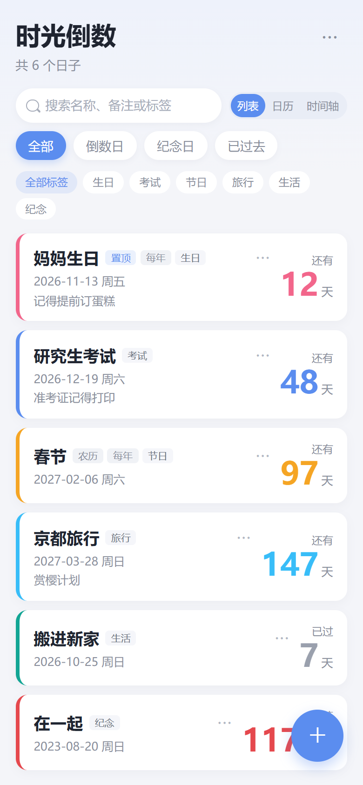
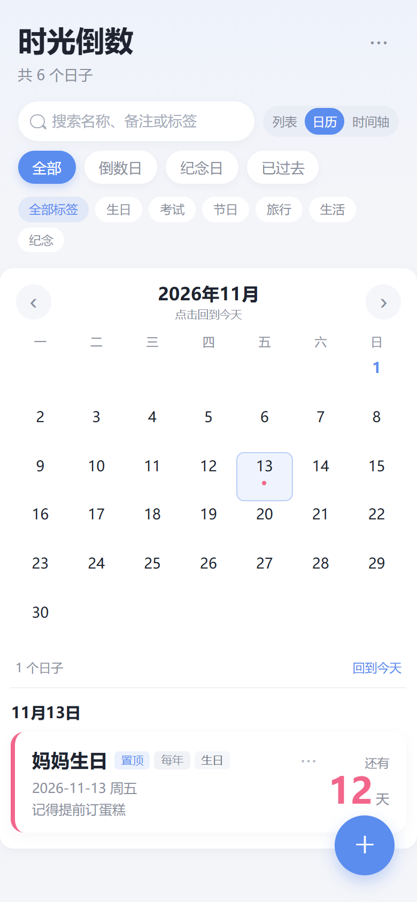
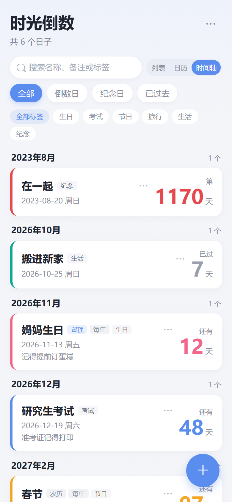
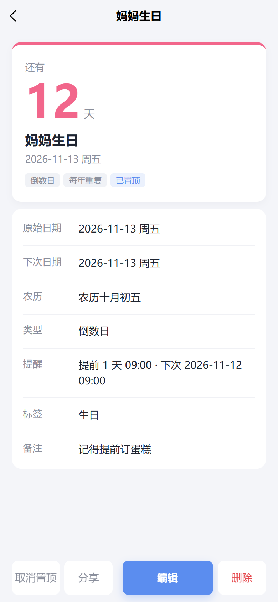
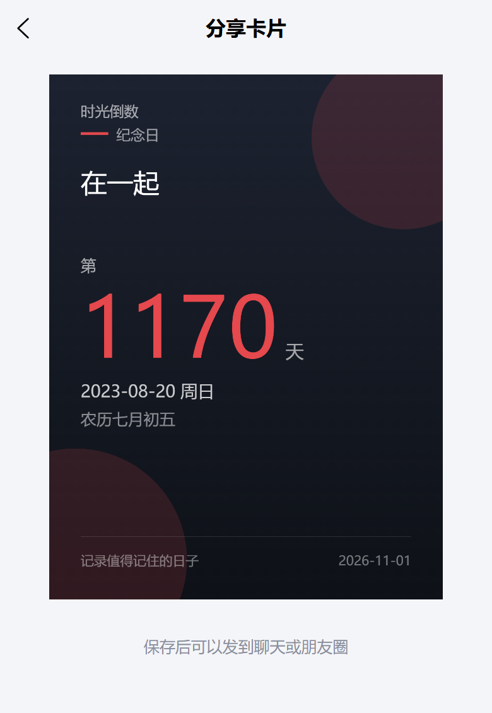
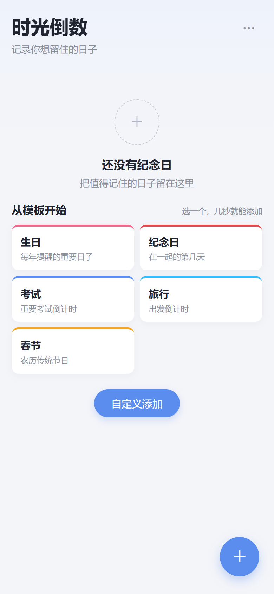

<h1 align="center">时光倒数</h1>

<p align="center">
  记录倒数日、纪念日与农历生日的跨端小应用。<br />
  数据保存在本机，不采集、不上传。
</p>

<p align="center">
  
  
  
  
</p>

## 预览

> 以下截图取自 H5 端，使用演示数据。实际界面会随平台与系统字体略有差异。

<table>
  <tr>
    <td align="center"></td>
    <td align="center"></td>
    <td align="center"></td>
  </tr>
  <tr>
    <td align="center">列表视图</td>
    <td align="center">日历视图</td>
    <td align="center">时间轴视图</td>
  </tr>
  <tr>
    <td align="center"></td>
    <td align="center"></td>
    <td align="center"></td>
  </tr>
  <tr>
    <td align="center">纪念日详情</td>
    <td align="center">分享卡片</td>
    <td align="center">空状态与快捷模板</td>
  </tr>
</table>

## 功能

- **倒数日与纪念日**：支持「还有 N 天」的倒数日，以及「第 N 天」的纪念日计数。
- **农历**：内置 1900–2100 年农历换算，可为农历生日、春节等设置每年重复，自动计算下一次公历日期。
- **每年重复**：公历生日、周年纪念等按年循环；农历节日按农历日期解析。
- **三种浏览方式**：列表、月历、时间轴，随时切换。
- **整理与查找**：按类型筛选、标签筛选、关键词搜索，支持置顶。
- **到点提醒**：可设置当天、提前 1 / 3 / 7 天及提醒时间（各端能力见下表）。
- **分享卡片**：生成深色主题的纪念日海报，可保存到相册（H5 端为下载图片）。
- **快捷模板与新手引导**：生日、纪念日、考试、旅行、春节 5 个模板，首次启动有引导。
- **导入导出**：通过剪贴板以 JSON 备份和合并数据，换设备前可自行迁移。
- **本地优先**：不接入账号、广告、统计和第三方 SDK，卸载或清缓存前请先导出备份。

## 平台支持

| 能力 | H5 | 微信小程序 | App |
| --- | --- | --- | --- |
| 记录、农历、重复、搜索、标签、三种视图 | ✅ | ✅ | ✅ |
| 分享卡片 | 下载图片 | 保存到相册、分享图片 | 保存到相册 |
| 到点提醒 | 仅页面打开时 | 暂未接入订阅消息 | 本地通知 |
| 数据导入 / 导出 | ✅ | ✅ | ✅ |
| 桌面小组件 | — | — | 规划中 |

> 提醒在 App 端依赖 Push 模块与系统通知权限；微信小程序需要订阅消息模板、用户授权与后端发送，因此暂缓。

## 技术栈

- [uni-app](https://uniapp.dcloud.net.cn/) + Vue 3 `<script setup>`
- SCSS，`rpx` 响应式布局，自定义导航与跨端安全区适配
- 无后端、无数据库，使用 `uni.setStorageSync` 本地持久化
- 内置农历换算与日期计算，不依赖网络和第三方库
- canvas 绘制分享卡片，按端区分保存逻辑

## 项目结构

```text
countdown-days/
├─ pages/
│  ├─ index/        # 首页：列表 / 日历 / 时间轴、搜索筛选、导入导出入口
│  ├─ detail/       # 纪念日详情
│  ├─ edit/         # 新建 / 编辑纪念日
│  ├─ share/        # 分享卡片生成与保存
│  ├─ settings/     # 设置：数据管理、提醒说明、重看引导
│  └─ about/        # 关于与隐私说明
├─ components/
│  ├─ EventCard.vue     # 纪念日卡片
│  ├─ MonthCalendar.vue # 月历视图
│  ├─ TemplateGrid.vue  # 首页快捷模板
│  └─ GuideOverlay.vue  # 首次启动引导
├─ composables/
│  ├─ useEvents.js      # 事件读写、排序、合并
│  └─ useReminders.js   # 分端提醒调度
├─ utils/
│  ├─ date.js           # 日期计算与展示数据
│  ├─ lunar.js          # 农历换算（1900–2100）
│  ├─ reminder.js       # 提醒时间计算
│  ├─ storage.js        # 本地存储与数据校验
│  ├─ importExport.js   # 剪贴板 JSON 导入导出
│  ├─ onboarding.js     # 新手引导状态
│  └─ templates.js      # 快捷模板
├─ static/logo.png
├─ docs/screenshots/    # README 截图
├─ App.vue
├─ pages.json
├─ manifest.json
└─ uni.scss
```

## 运行

项目以 HBuilderX 工程方式维护，推荐使用 HBuilderX 运行与调试。

1. 安装 [HBuilderX](https://www.dcloud.io/hbuilderx.html)（App 开发版）。
2. 选择「文件 → 导入 → 从本地目录导入」，指向本项目根目录。
3. 通过「运行」菜单选择目标平台：
   - **运行到浏览器**：H5 调试，默认端口 `5173`。
   - **运行到小程序模拟器 → 微信开发者工具**：需安装微信开发者工具。
   - **运行到手机或模拟器**：App 端调试，需要连接 Android 设备或启动模拟器。

也可以使用 HBuilderX 自带的 CLI（先启动 HBuilderX）：

```bash
# H5 开发服务器
cli launch web --project <项目绝对路径>

# 编译到微信小程序
cli launch mp-weixin --project <项目绝对路径> --compile true
```

> 若要发布为自己的小程序，请把 `manifest.json` 中的 `mp-weixin.appid` 替换成你的 AppID。

## 数据与隐私

- 所有记录仅保存在当前设备的本地缓存中，键名为 `countdown_events`。
- 不收集、不上传个人信息；不接入广告、统计和第三方 SDK。
- 剪贴板仅在主动导入 / 导出时读写；相册权限仅在保存分享卡片时请求。
- 导出内容为 JSON，可直接作为备份，也可在另一台设备上导入合并：

```json
{
  "app": "countdown-days",
  "version": 1,
  "exportedAt": "2026-11-01T00:00:00.000Z",
  "list": [
    {
      "title": "妈妈生日",
      "targetDate": "2026-11-13",
      "type": "countdown",
      "repeat": "yearly",
      "calendar": "solar",
      "tags": ["生日"]
    }
  ]
}
```

## 路线图

- [ ] 深色模式
- [ ] 微信小程序订阅消息提醒（依赖后端 / 云函数）
- [ ] App 桌面小组件
- [ ] 多端同步（在确有需要时再引入 uniCloud）

## 反馈

欢迎通过 [Issues](https://github.com/Ilovederrickrose5/countdown-days/issues) 反馈问题或提出建议。
